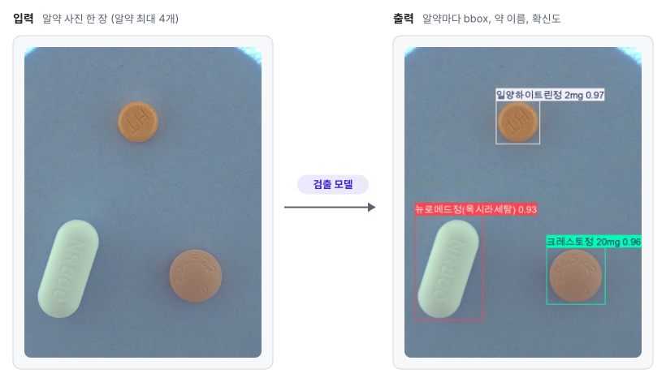
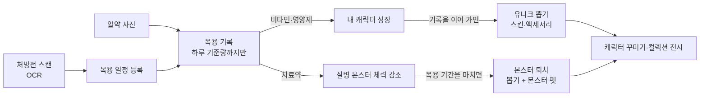
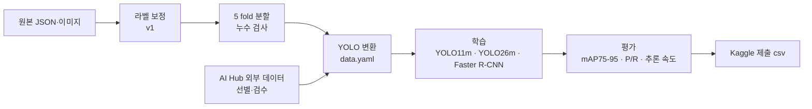
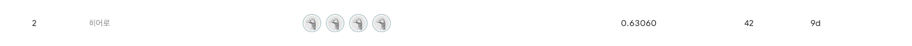
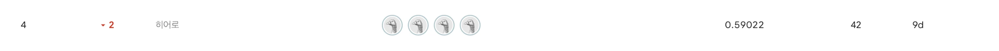
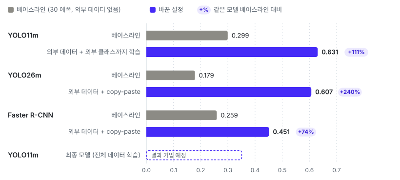

<div align="center">


# 알약몬 <sub><sup>(구 먹었약)</sup></sub>

**알약 사진 한 장으로 복용을 기록하는 서비스의 알약 인식 모델**

알약 사진에서 알약마다 위치(bbox)와 종류를 찾습니다.

**🚀 [서비스 열기](https://def-uk.github.io/pill-bbox-front/) · 📄 [보고서 (PDF)](https://raw.githubusercontent.com/def-uk/pill-bbox/main/docs/report/report.pdf) · 🎤 [발표자료 (PDF)](https://raw.githubusercontent.com/def-uk/pill-bbox/main/presentations/alyakmon_pt.pdf)**

</div>

## 서비스

<div align="center">
<a href="https://github.com/def-uk/pill-bbox-front/blob/main/docs/media/demo.mp4"></a>

**[서비스 열기](https://def-uk.github.io/pill-bbox-front/)**
</div>

## 팀

<table>
  <tr>
    <td align="center" valign="top" width="25%">
      <a href="https://github.com/def-uk"><br/><b>동욱</b></a><br/>
      <sub><a href="https://github.com/def-uk">@def-uk</a></sub><br/><br/>
      <sub>데이터 파이프라인·학습·평가 코드, Faster R-CNN 베이스라인, YOLO26m 실험, 프론트엔드 데모, README</sub>
    </td>
    <td align="center" valign="top" width="25%">
      <a href="https://github.com/gwon753-dev"><br/><b>영현</b></a><br/>
      <sub><a href="https://github.com/gwon753-dev">@gwon753-dev</a></sub><br/><br/>
      <sub>라벨 보정, YOLO11m 베이스라인·외부 데이터·모자이크·OCR 실험, 프로젝트 문서화</sub>
    </td>
    <td align="center" valign="top" width="25%">
      <a href="https://github.com/JJAM99"><br/><b>재민</b></a><br/>
      <sub><a href="https://github.com/JJAM99">@JJAM99</a></sub><br/><br/>
      <sub>YOLO11m 베이스라인·증강 실험, 외부 데이터 1·2차 EDA·전처리</sub>
    </td>
    <td align="center" valign="top" width="25%">
      <a href="https://github.com/younghoon1215"><br/><b>영훈</b></a><br/>
      <sub><a href="https://github.com/younghoon1215">@younghoon1215</a></sub><br/><br/>
      <sub>YOLO26m 베이스라인, Faster R-CNN 실험, 발표 자료</sub>
    </td>
  </tr>
</table>

## 문제 정의

> **어떻게 하면 1020세대가 복용 기록을 꾸준히 하게 할까?**

1020세대도 비타민·영양제를 매일 챙기고, 감기나 피부 질환으로 며칠에서 몇 주씩 처방약을 먹습니다.
어려운 것은 약을 먹는 일보다 **먹었는지 기록하고 정해진 기간을 끝까지 지키는 일**입니다.
기록할 이유가 없으면 며칠 만에 그만두고, 처방약은 증상이 나아지면 남은 기간을 빠뜨리기 쉽습니다.

알약몬은 알약 사진을 찍으면 어떤 약인지 알아보고 찍은 시각에 먹은 것으로 기록합니다.
그리고 그 기록을 **캐릭터 성장과 질병 몬스터 퇴치**로 보여 줘서, 기록을 이어 갈 이유를 만듭니다.

<picture>
  <source media="(prefers-color-scheme: dark)" srcset="docs/assets/io_dark.svg">
  
</picture>

## 서비스 구상

이 저장소의 검출 모델이 "무슨 약을 먹었는지"를 알아내면, 알약몬은 그 기록을 약 종류에 따라 두 가지 성장 루프로 연결합니다.



| 기능 | 내용 |
|---|---|
| 처방전 스캔으로 일정 등록 | OCR로 약 이름, 복용 기간, 하루 복용 횟수, 1회 알 수를 읽고 사용자가 확인·수정하면 복용 일정이 됩니다. |
| 비타민·영양제 → 캐릭터 성장 | 일정대로 기록하면 캐릭터가 자라고, 기록을 이어 가면 유니크 뽑기로 스킨·액세서리를 얻습니다. |
| 치료약 → 질병 몬스터 퇴치 | 약을 등록하면 질병 몬스터가 나타납니다. 체력은 처방 기간에 맞추고, 하루치를 다 먹을 때마다 줄어듭니다. |
| 모으고 보여 주는 보상 | 유니크 스킨과 몬스터 펫을 장착하거나 컬렉션에 전시해 "나도 갖고 싶다"는 마음이 들게 합니다. |
| 하루 기준량까지만 보상 | 치료약은 처방된 하루 복용량, 영양제는 제품의 하루 권장량까지만 반영합니다. 넘긴 기록에는 성장·체력 감소·뽑기가 없습니다. |

> [!NOTE]
> 캐릭터 성장, 몬스터 퇴치, 처방전 스캔은 아직 확장 제안 단계입니다. 기능별 상세 설명은 [docs/SERVICE_PLAN.md](docs/SERVICE_PLAN.md)에 있습니다.

## 데이터

| 구분 | 내용 |
|---|---|
| 대회 데이터 | train 이미지 232장, annotation JSON 763개(bbox 763개), test 이미지 842장, 클래스 56종 |
| 외부 데이터 | [AI Hub 경구약제 이미지 데이터](https://www.aihub.or.kr/aihubdata/data/view.do?currMenu=115&topMenu=100&aihubDataSe=data&dataSetSn=576)의 조합 데이터. train에만 추가하고 검증은 대회 사진으로만 함 |
| 평가 지표 | mAP@[0.75:0.95] (IoU 0.75–0.95 다섯 기준의 AP 평균). 코드에서는 `mAP75-95` |

EDA로 찾은 문제와 처리:

- **라벨 오류**: 누락 라벨 8개를 추가하고 위치가 틀린 박스 5개와 잘린 캡슐 박스를 고쳐 기본 라벨 `v1`(bbox 771개)을 만들었습니다.
  원본 JSON은 고치지 않고 보정 기록(`data/processed/corrections.csv`)으로 적용합니다.
- **누수**: 같은 약 조합을 각도만 바꿔 찍은 사진이 많아, 무작위로 나누면 검증 점수가 부풀려집니다.
  조합 단위(`combo_v1_s42`)와 촬영 세팅 단위(`setup30fix_v1_s42`) 5 fold 분할을 만들었습니다.
  최종 모델은 조합 단위에서 bbox 5개 이하의 희귀 약이 든 조합을 train에 고정한 `combofix_v1_s42`를 씁니다(최종 모델 노트북이 만듭니다).
- **클래스 불균형**: 희귀 약 때문에 AI Hub 외부 데이터를 가져왔습니다. 대회 56종과 겹치는 클래스는 클래스당 bbox 157개까지 채우고,
  박스가 맞지 않는 사진은 사람이 검수해 빼거나 고쳤습니다(2차 EDA). 대회에 없는 약은 새 클래스로 학습하고 평가에서는 뺍니다.

자세한 데이터 구조는 [data/README.md](data/README.md), 만드는 방법은 [docs/DATA_PIPELINE.md](docs/DATA_PIPELINE.md)를 참고하세요.

## 접근 방법



- **후보 모델**: one-stage(YOLO11m, YOLO26m)와 two-stage(Faster R-CNN)를 같은 데이터 전략과 지표로 비교했습니다. 분할과 실행 환경은 모델마다 달랐습니다.
  YOLO26m은 NMS 없이 바로 박스를 내는 출력층(end-to-end)도 함께 평가했습니다.
- **공통 베이스라인**: 같은 하이퍼파라미터와 평가 코드로 맞춘 뒤 실험마다 변수 하나만 바꿨습니다. YOLO11m은 `combofix` 5 fold, YOLO26m은 `combo` 단일 holdout으로 학습했습니다.
- **평가**: mAP75-95를 주 지표로 `best.pt`와 early stopping을 정하고, 정밀도·재현율·추론 속도·혼동행렬·실패 사례를 함께 봤습니다.
  성능이 오르든 내리든 모든 실험을 문서화했습니다.

공통 베이스라인 설정:

| 항목 | 값 |
|---|---|
| 이미지 크기 / 배치 | 640 / 16 (GPU 메모리에 따라 8·4) |
| epochs / patience | 100 / 10 |
| 옵티마이저 | MuSGD, lr0 0.001, warmup 3 에폭 |
| 증강 (`on`) | 뒤집기 끔, 회전 10°, 색조 0.005 (알약 각인과 색이 클래스를 가르므로 약하게) |
| seed | 42 |
| 평가 | conf 0.001, max_det 4 |

## 실험

실험마다 베이스라인 대비 한 가지만 바꿨습니다.

### 1. 베이스라인 및 아키텍처 비교

one-stage와 two-stage 후보를 같은 데이터와 평가 코드로 비교했습니다.

<table>
  <tr><th width="480" align="left">실험</th><th width="240" align="left">모델</th></tr>
  <tr><td>베이스라인 구축 (분할, 평가 지표, training loop, 혼동행렬, 실패 사례 시각화, 제출 csv)</td><td>YOLO11m, YOLO26m, Faster R-CNN</td></tr>
  <tr><td>100 에폭 학습</td><td>YOLO11m, Faster R-CNN</td></tr>
</table>

### 2. 데이터 품질 개선

희귀 클래스를 채우려고 외부 데이터를 더하고, 박스가 맞지 않는 사진은 걸러 냈습니다.

<table>
  <tr><th width="480" align="left">실험</th><th width="240" align="left">모델</th></tr>
  <tr><td>AI Hub 외부 데이터 추가</td><td>YOLO11m, YOLO26m, Faster R-CNN</td></tr>
  <tr><td>2차 EDA로 선별·검수한 외부 데이터</td><td>YOLO11m, YOLO26m</td></tr>
</table>

### 3. 증강 기법 비교

알약은 각인과 색이 클래스를 가르므로 어떤 증강이 도움이 되고 해가 되는지 하나씩 확인했습니다.

<table>
  <tr><th width="480" align="left">실험</th><th width="240" align="left">모델</th></tr>
  <tr><td>모자이크 증강 켜기·끄기</td><td>YOLO11m, YOLO26m, Faster R-CNN</td></tr>
  <tr><td>회전 증강</td><td>YOLO11m, Faster R-CNN</td></tr>
  <tr><td>Copy-paste 증강 (정답 bbox를 잘라 다른 사진에 붙이는 방식을 직접 구현)</td><td>YOLO11m, YOLO26m, Faster R-CNN</td></tr>
  <tr><td>최고 모델에서 모자이크 끄기, 채도·색조·밝기 증강 줄이기</td><td>YOLO11m</td></tr>
</table>

### 4. 학습 방식 변경

<table>
  <tr><th width="480" align="left">실험</th><th width="240" align="left">모델</th></tr>
  <tr><td>각인 OCR을 함께 학습해 재분류</td><td>YOLO11m, YOLO26m</td></tr>
</table>

### 5. 최종 모델

<table>
  <tr><th width="480" align="left">실험</th><th width="240" align="left">모델</th></tr>
  <tr><td>검증 없이 전체 데이터(train + val)로 seed 5개 학습. 0.63060을 넘지 못해 채택하지 않음</td><td>YOLO11m</td></tr>
</table>

최종 모델은 **외부 데이터 + 외부 클래스까지 학습한 YOLO11m의 fold 1 `best.pt`** (Kaggle 0.63060)입니다.
서비스 앱의 `combofix-v1-fold1-w8`이 이 가중치를 int8로 줄인 모델입니다.

실험별 노트북·PR·점수는 [실험 지도](docs/EXPERIMENTS.md)에 모았습니다. main에는 최종 모델 노트북만 남겼고, 실험 노트북은 모델별 실험 브랜치(`exp/yolo11m`, `exp/yolo26m`, `exp/faster_r-cnn`)에 있습니다.

## 결과

<br/>
<sub>Kaggle Public 2위 (0.63060)</sub>

<br/>
<sub>Kaggle Private 4위 (0.59022)</sub>

<picture>
  <source media="(prefers-color-scheme: dark)" srcset="docs/assets/results_dark.svg">
  
</picture>

자세한 내용 보기 → [보고서 (PDF)](https://raw.githubusercontent.com/def-uk/pill-bbox/main/docs/report/report.pdf) · [웹에서 보기](https://raw.githack.com/def-uk/pill-bbox/main/docs/report/report.html)

## 더 보기

<details>
<summary><b>시작하기</b></summary>

[uv](https://docs.astral.sh/uv/)로 Python 3.12와 패키지를 맞춥니다.

```bash
git clone https://github.com/def-uk/pill-bbox.git && cd pill-bbox
uv sync                                                   # 환경 만들기
git config core.hooksPath .githooks                       # main 직접 커밋 방지 hook
cp .env.example .env                                      # DATA_URL, WANDB_API_KEY 등 입력
uv run python -m data_process.data_main --label v1        # 원본 → 라벨 → 분할 → data.yaml
```

학습은 최종 모델 노트북 [notebooks/yolo11m.ipynb](notebooks/yolo11m.ipynb)에서 합니다. 노트북의 "팀원 실행 가이드"를 따라 GPU(Colab)에서 실행하세요.

대회 56종만 학습한 `best.pt`로 Kaggle 제출 csv만 만들 때(96종을 학습한 최종 모델은 노트북 15단계에서 만듭니다):

```bash
uv run python -m models.evaluate --weights <best.pt 경로> --exp <실험 이름>
```

데이터 파이프라인과 평가 함수는 [docs/DATA_PIPELINE.md](docs/DATA_PIPELINE.md)를 참고하세요.

</details>

<details>
<summary><b>개발 가이드</b></summary>

#### 치트시트

| 상황 | 명령 |
|---|---|
| pull 받은 뒤 | `uv sync` |
| 실험 노트북 패키지(easyocr, optuna 등)까지 | `uv sync --group exp` |
| 학습 데이터 만들기 | `uv run python -m data_process.data_main --label v1` |
| 노트북 열기 | `uv run jupyter lab` |
| 패키지 추가 / 제거 | `uv add <패키지>` / `uv remove <패키지>` |
| 개발용 패키지 추가 | `uv add --dev <패키지>` |
| 커밋 전 코드 정리 | `uv run ruff format .` → `uv run ruff check . --fix` |
| Mac에서 MPS 에러 | `PYTORCH_ENABLE_MPS_FALLBACK=1 uv run python <파일>` |
| wandb 끄고 실행 | `WANDB_MODE=disabled uv run python <파일>` |

작업 흐름:

```bash
git switch main && git pull && uv sync      # 최신 상태로 맞추기
git switch -c feat/<짧은-설명>                # 브랜치 만들기
# ... 작업 ...
uv run ruff format . && uv run ruff check . --fix
git add <파일> && git commit -m "feat: <요약>"
git push -u origin feat/<짧은-설명>
gh pr create --base main                     # PR 본문은 템플릿을 채움
```

- 패키지는 `uv add`로만 추가하고 `pyproject.toml`과 `uv.lock`을 함께 커밋합니다. `pip install`은 쓰지 않습니다.
- 노트북은 출력을 지운 뒤 커밋합니다. 결과 기록으로 출력을 남길 때는 PR에 이유를 적습니다(`01_eda.ipynb`, `yolo11m.ipynb`).

#### 환경

| OS | PyTorch | 장치 |
|---|---|---|
| macOS | PyPI 기본 빌드 | `mps` (Apple GPU) |
| Windows / Linux | CUDA 12.6 빌드 | `cuda` (NVIDIA GPU) |

장치는 `src/config.py`의 `get_device()`가 고릅니다(cuda → mps → cpu). 코드에 `"cuda"`, `"mps"`를 직접 쓰지 않습니다.

#### 실험 기록 (wandb)

`.env`에 [API 키](https://wandb.ai/authorize)와 팀 이름(`WANDB_ENTITY`)을 넣고, 학습 전에 `init_wandb()`를 부릅니다.
ultralytics 전역 설정은 바꾸지 않으므로 이 프로젝트 밖의 YOLO 학습에는 영향이 없습니다.

```python
from ultralytics import YOLO

from src.config import get_device, init_wandb

model = YOLO("yolo11m.pt")
init_wandb(model, run_name="yolo11m-baseline", config={"seed": 42})
model.train(data="data.yaml", epochs=100, device=get_device())
```

인터넷 없이 기록만 남기려면 `WANDB_MODE=offline`, 나중에 `uv run wandb sync wandb/offline-run-*`로 올립니다.

</details>

<details>
<summary><b>폴더 구조</b></summary>

```
pill-bbox/
├── data/               # 데이터 (이미지·annotation은 커밋 안 함)
├── data_process/       # 데이터 파이프라인 (라벨 보정, 분할, YOLO 변환, AI Hub 읽기)
├── models/             # 평가·제출(evaluate.py)
├── notebooks/          # 최종 모델(yolo11m.ipynb), EDA. 실험 노트북은 exp/* 브랜치
├── src/                # 공통 설정 (config.py)
├── docs/               # 컨벤션, 데이터 파이프라인, 실험 지도, YOLO26m 재검토
│   └── report/         # 실험 결과 보고서 (HTML·PDF)
├── presentations/      # 최종 발표 자료(PDF), 모델별 실험 발표 자료(HTML)
├── visualization.py    # 그림 그리기 공통 함수
├── pyproject.toml
└── uv.lock
```

</details>

## 관련 문서

| 문서 | 내용 |
|---|---|
| [서비스 구상](docs/SERVICE_PLAN.md) | 캐릭터 성장, 몬스터 퇴치, 처방전 스캔 등 확장 제안 |
| [서비스 앱 저장소](https://github.com/def-uk/pill-bbox-front) | Flutter 앱 코드, 앱에 넣은 모델 설명 |
| [실험 지도](docs/EXPERIMENTS.md) | 실험별 노트북·PR·점수 |
| [YOLO26m 제외 결정 재검토](docs/YOLO26M_REVIEW.md) | 모델 선택 근거를 다시 따져 본 기록 |
| [데이터 파이프라인](docs/DATA_PIPELINE.md) | 라벨 버전, 분할, 학습·평가 명령 |
| [데이터 폴더 구조](data/README.md) | 폴더 구조, 외부 데이터, annotation JSON 구조 |
| [코드 컨벤션](docs/CODE_CONVENTION.md) · [Git 컨벤션](docs/GIT_CONVENTION.md) | 포맷·이름 규칙, 커밋·브랜치·PR 규칙 |
| [협업 일지 (Notion)](https://app.notion.com/p/4051a367c3dc8014b321ce35b8487ce5?v=4051a367c3dc8043b777000cd47de162&source=copy_link) | 회의와 작업 기록 |
